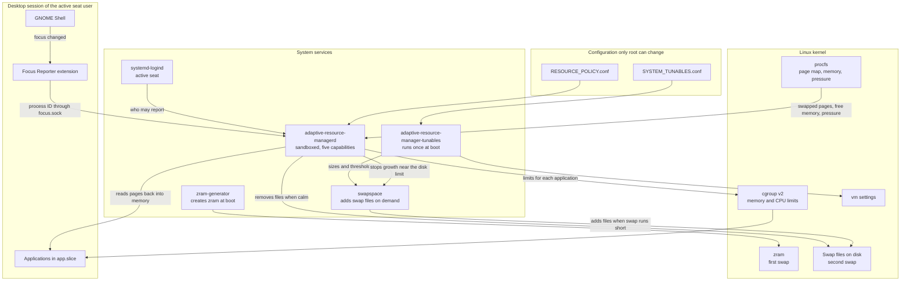

# Adaptive Resource Manager

Gives the application you click priority over memory and CPU, and brings its swapped pages back in
small steps. It applies to every desktop application, not to a fixed list. When swap space is no longer
needed, the disk space goes back without waiting.

Amounts are never absolute. Memory is a percentage of total memory, CPUs are selected by class or
share, and the read rate follows how busy the disk is.

Maintainer: Samed Emre Çetinkaya

## Disclaimer

This software runs as root. It changes memory limits, CPU priorities, kernel settings and swap, and it
removes swap files. A wrong setting or a bug can slow down or stop applications, make the system
unresponsive, or lose unsaved work and data.

It has been tested on one machine only: x86-64, 16 GB of memory, Debian 13, GNOME 48 on Wayland and a
Linux 7.2 kernel. Behavior on other systems is calculated or assumed, not measured.

The software is provided "as is", without warranty of any kind. You use it at your own risk, and the
authors accept no liability for any damage or loss. Read the scripts and keep backups before you install
it. The [LICENSE](LICENSE) has the full terms.

## Requirements

The daemon uses no third-party libraries. At run time it links only to the C library. "Tested with" is
the one machine this has run on, not a minimum.

### To build

| Need | Why | Tested with |
| --- | --- | --- |
| C compiler with C11 and GNU extensions | Builds the daemon. GCC 12 or newer is needed for `_FORTIFY_SOURCE=3` | GCC 14.2 |
| GNU Make | Build steps | 4.4.1 |
| C library headers | Standard and Linux system calls | glibc 2.41 |
| Linux headers 6.7 or newer | `PAGEMAP_SCAN` in `<linux/fs.h>` | 7.2 |

### To run

| Need | Why | Tested with |
| --- | --- | --- |
| x86-64 | The page scan's address range is written for it | x86-64 |
| Linux 6.7 or newer | `PAGEMAP_SCAN`, `process_madvise` and `memory.reclaim` | 7.2 |
| Kernel options `CONFIG_MEMCG`, `CONFIG_SWAP`, `CONFIG_PROC_PAGE_MONITOR` and `CONFIG_PSI` | Limits, swap, page scan and memory pressure | Enabled |
| Pressure information turned on | If `/proc/pressure/memory` is missing, the daemon treats the system as never calm, so it does no idle read and retires no swap file by itself. Add `psi=1` to the kernel command line if your kernel has it off by default | Available |
| cgroup v2 with `memory_recursiveprot` | Protection must reach the groups inside an application. systemd usually mounts it this way | Enabled |
| systemd with user managers and logind | Application groups under `app.slice`, and the active seat in `/run/systemd/seats` | 257 |
| GNOME on Wayland | The focus reporter. Without it no application becomes foreground, and only the background policy and swap return work. The extension declares GNOME 48 only | 48.7 |

### To enable the memory settings and run the scripts

| Need | Used by | Tested with |
| --- | --- | --- |
| `swapspace` | `ENABLE_ENFORCE.sh`, for swap files. The disk limit works through it | 1.18 |
| `zram-generator` | `ENABLE_ENFORCE.sh`, for the zram device | 1.2.1 |
| A filesystem that `swapon` accepts files from | Swap files | ext4 |
| `util-linux`: `runuser`, `setpriv`, `fallocate`, `mkswap`, `swapon`, `swapoff`, `taskset` | Scripts and tests | 2.41 |
| `coreutils`, `awk`, `sed`, `getent` and `procps`: `sysctl`, `pgrep` | Scripts and tests | coreutils 9.7, gawk 5.2, procps 4.0 |
| `python3` | Tests only | 3.13 |

On Debian:

```sh
sudo apt install build-essential linux-libc-dev python3 swapspace systemd-zram-generator
```

The other tools come with a standard Debian system.

If your kernel enables zswap by default, disable it with `zswap.enabled=0` on the kernel command line.
It would compress pages twice on top of zram.

## Installation

Run these from your own account. `sudo` tells the scripts which user owns the desktop session.

```sh
make                              # build
make test                         # no root, no real setting touched
sudo sh TESTS/RUN_ROOT_TESTS.sh   # real kernel test with its own swap file, about one minute
sudo sh SCRIPTS/INSTALL.sh        # OBSERVE mode: logs only, changes no limit
gnome-extensions enable focus-reporter@adaptive-resource-manager   # after logging out and back in
sudo sh SCRIPTS/ENABLE_ENFORCE.sh # relative settings and ENFORCE mode, backups first
sudo reboot                       # the zram size changes at boot
sh TESTS/RUN_PRESSURE_TEST.sh     # 140% of memory on the new settings. Close your work first.
sudo sh TESTS/RUN_DISK_GUARD_TEST.sh # disk limit with the real swapspace, without filling the disk
```

Check the state with `cat /run/adaptive-resource-manager/STATUS`. The log is in
`journalctl -u adaptive-resource-manager`. `event=FOCUS_STALL` reports how long an application stalled
right after a click, which is the number to compare before and after enforcing.

`FOREGROUND_CPU_WEIGHT=UNAVAILABLE` means the CPU controller is off for that group. systemd enables it in
`app.slice` only while a member asks for it, so `INSTALL.sh` makes every `app-*.scope` ask. This applies
to applications started after the install.

To undo:

```sh
sudo sh SCRIPTS/DISABLE_ENFORCE.sh /var/backups/adaptive-resource-manager/<timestamp>
sudo sh SCRIPTS/UNINSTALL.sh
```

## Architecture



The daemon itself is split by responsibility:

| File | Responsibility |
| --- | --- |
| `SOURCE/main.c` | Main loop, focus socket, sender checks and status file |
| `SOURCE/app_groups.c` | Finding application groups, writing their limits and saving the original values |
| `SOURCE/readback.c` | Finding swapped pages, paced reads, releasing pages, removing swap files and the disk limit |
| `SOURCE/system_info.c` | Finding CPU classes, swap devices, backing disks and GPU use |
| `SOURCE/config.c` | Reading and validating the policy |
| `SOURCE/util.c` | File, path, seat and kernel statistics helpers |

## Repository

| Part | Purpose |
| --- | --- |
| `SOURCE/` | `adaptive-resource-managerd`, the daemon |
| `GNOME_EXTENSION/` | Reports the focused window's process ID. Sends no titles. |
| `CONFIG/RESOURCE_POLICY.conf` | Focus, memory, CPU and readback policy |
| `CONFIG/SYSTEM_TUNABLES.conf` | zram, swapspace and sysctl values relative to memory |
| `SYSTEMD/` | Service units and the CPU controller rule |
| `SCRIPTS/` | Install, enable, disable and uninstall |
| `TESTS/` | Unprivileged tests and real kernel tests |

## How it works

At a focus change:

1. The window's process is mapped to its application group, the direct child of `app.slice`. A
   terminal and its shells, or a browser and its helpers, count as one application.
2. The group gets `FOREGROUND_MEMORY_HIGH_PERCENT`, `FOREGROUND_MEMORY_LOW_PERCENT` protection through
   its ancestors, and a higher CPU weight.
3. Its swapped pages are read back with `process_madvise(MADV_WILLNEED)`. Another focus change cancels
   the read.
4. After `BACKGROUND_GRACE_SECONDS` the previous group returns to the background policy.

Separately, a swap file goes back to the disk as soon as the system is calm and `swapoff` would read at
most `SWAP_FILE_RETIRE_UNREACHABLE_PERCENT` of memory. Pages still in the swap cache need no read, so a
file can hold more than that. There is no waiting period for this, and focus changes do not delay it. A
file that would need a longer read waits until the system stays calm for `IDLE_READBACK_CALM_SECONDS`.
Its pages are then read back in small steps. If memory is needed, the read stops and its pages are
released without being written. The file is retired when almost nothing would have to be read at once,
because `swapoff` cannot be interrupted inside a single large process.

When the disk that holds the swap files gets close to `SWAP_FILE_MIN_FREE_DISK_PERCENT` free space, no new
swap file is opened, even if memory runs out and the kernel has to kill a process. Growth stops one
largest file early, so a new file cannot cross the limit. Under the limit, empty swap files go back at once.
Files that hold pages stay in use. They take no more disk as they fill, and removing them under pressure
would read their pages back into memory that is already short.

The zram size is only a ceiling and takes no memory until pages arrive, so monitors count it in the swap
total even when nothing uses it. Only swap files take real disk space.

## Default values

One set of percentages serves 8, 16, 24 and 32 GB machines. The 8 GB machine is the tightest, so it
sets most limits, and larger machines get more room from the same percentages. `make test` checks these
constraints at each size, using about 1 GiB less than the nominal size as usable memory.

| Value | Constraint |
| --- | --- |
| `FOREGROUND_MEMORY_HIGH_PERCENT=65.00` | Leaves room for the hot desktop (about 1.4 GiB) and 15% clean cache, which kernels with `vm.clean_min_ratio` can protect |
| `FOREGROUND_MEMORY_LOW_PERCENT=30.00` | Protects a typical foreground working set of about 2 GiB |
| `BACKGROUND_MEMORY_HIGH_PERCENT=55.00` | Fits a measured 3.6 GiB background build, and stays below the foreground limit |
| `FOREGROUND_READBACK_RESERVE_PERCENT=20.00` | Stops above that clean cache with at least 256 MiB to spare |
| `IDLE_READBACK_RESERVE_PERCENT=30.00` | Idle work always yields before focused work |
| `ZRAM_SIZE_PERCENT=70.00` | A full device at 2:1 compression still leaves working memory |
| `SWAP_FREE_TARGET_PERCENT=23.00` with `SWAP_LOWER_FREE_LIMIT_PERCENT=20.00` | Under a slow load a new swap file adds about 3% of memory plus swap, calculated as 0.8 GiB on 16 GB. The kernel allows about 23 swap files besides zram, so this also lets disk swap reach about 23 GiB on 16 GB |
| `SWAP_FILE_MAX_PERCENT=13.00` | Under a fast load swapspace falls behind and new files grow up to this size, about 2 GiB on 16 GB. A 21.5 GiB load used 11 of the 23 files, sized 1.1 to 2.0 GiB. At 6.50 it used 17 |
| `READBACK_MAX_CHUNK_PERCENT_OF_MEMORY=0.05` | At most 16 MiB, measured at about 5 ms per call |
| `SWAP_FILE_RETIRE_UNREACHABLE_PERCENT=1.00` | The expected `swapoff` read stays under about 3 s |
| `SWAP_FILE_RETIRE_WORST_CASE_READ_PERCENT=5.00` | The kernel counts the swap cache for all devices together, so that estimate can be wrong. This bounds the read at about 7 s on 16 GB and 14 s on 32 GB, measured at 8.85 s/GiB |
| `SWAP_FILE_MIN_FREE_DISK_PERCENT=5.00` | Keeps room for other programs: 16 GiB on a 327 GiB disk, 3.2 GiB on a 64 GiB disk. `0` turns it off |
| `SWAP_FILE_GROWTH_MARGIN_PERCENT_OF_MEMORY=13.00` | Equal to `SWAP_FILE_MAX_PERCENT`, so one more file cannot cross the disk limit |
| `SWAP_FILE_RETIRE_MIN_FREE_SWAP_PERCENT=30.00` | At least 2 GiB remains, about 2 s of zram filling at a measured 1 GiB/s, and swapspace does not need a new file right away |

The workload figures were measured on one 16 GB machine. Other sizes are calculated, not measured.
The dirty page limits depend on the disk more than on memory, so re-measure them on other machines.

## Hardware support

Everything is discovered at runtime. Run `adaptive-resource-managerd --probe` to see the result.

- **CPU:** classes come from `cpu_capacity`, then CPPC, then maximum frequency. Selectors are `ALL`,
  `PERFORMANCE`, `EFFICIENCY`, `LOW_POWER` and `LEAST_BUSY`, each with an optional `:PERCENT`.
- **Disk:** the disk behind each swap file is resolved from its device number, so NVMe, SATA and
  rotational disks all work. The rate follows that disk's busy time.
- **GPU:** driver names and card numbers are never assumed. GPU memory is reported through the standard
  DRM fdinfo keys. The kernel has no driver independent way to prioritize one application on a GPU, so
  the daemon does not try. The `dmem` cgroup is detected and reported but not enforced.

## Security

The daemon needs root powers, so everything it accepts from outside is checked. It holds only
`CAP_SYS_ADMIN`, `CAP_SYS_NICE`, `CAP_SYS_PTRACE`, `CAP_DAC_OVERRIDE` and `CAP_CHOWN`, and has no network. Its unit also
limits system calls and makes everything except cgroups and the swap directory read-only. It reads where
other processes' pages are swapped, never the contents of their memory.

| Input | Check |
| --- | --- |
| Focus socket | Mode 600 and owned by the user at the active seat, or by root without one, so other users cannot fill its queue. A socket with the wrong owner or mode is replaced within about a second, which also drops anyone connected to the old one. The kernel supplies the sender's identity. The sender must be that user, and the process and group must belong to the sender. Other reports have no effect, and logging them is rate limited. |
| Group names, which users choose | Only `user.slice/user-UID.slice/user@UID.service/app.slice/UNIT` with a valid unit name is accepted. This keeps line breaks and forged fields out of logs and saved limits. |
| `RESOURCE_POLICY.conf` | As root, it must be a regular file, not a link, that only root can change. Unknown keys and invalid values stop the daemon. |
| `SYSTEM_TUNABLES.conf` | Same ownership rule. It is read as values and never executed. |
| Runtime directory | It must not be a link, and only the daemon's user may change it. Saved limits there are mode 600, and restored paths must be real application groups. |
| Swap files | Before `swapoff` and `unlink`, each file must be a regular file, not a link, directly inside a directory, and both must be changeable only by the daemon's user. |
| Memory use | Scan results and groups are capped: 512 groups per user, 3584 for all users without the active seat together, and 8192 in the table. A group that still exists is never dropped, so it keeps its original limits. The unit has `MemoryMax=1%`. |
| Cgroup files | Reads and writes do not follow links, in addition to cgroup v2 not allowing them. |
| Status file | Every local user can read it, so it names no application. |
| Scripts | `INSTALL.sh` and `UNINSTALL.sh` work in the user's home as that user, not as root. `DISABLE_ENFORCE.sh` restores only from a root-owned backup directory, and only under `/etc` and `/usr/local`. |

The build uses `_FORTIFY_SOURCE=3`, stack protection, PIE and full RELRO. `make test` runs the daemon under
AddressSanitizer and UndefinedBehaviorSanitizer, and `make analyze` runs GCC's static analyzer.

What this does not protect against:

- Any program of the user at the active seat can report a false focus and give one of that user's
  applications priority. The compositor offers no proof of which window really has focus.
- A remote login of the user at the active seat counts as that user.
- The user at the active seat can open the socket between two checks and let another user connect. That
  sender stays connected until the socket is next replaced and can fill its queue, but this harms only that
  seat user's own reports.
- `sudo sh SCRIPTS/...` runs files from a directory you own. Anything running as your user could change
  them first, so check `git status` and install from a clean state.
- Swap files are not encrypted by this software. Memory contents can reach the disk unless the disk itself
  is encrypted.

To report a security problem, contact the maintainer through GitHub before publishing details.

## Known limits

- It writes cgroup files directly, outside systemd's single writer rule. A manual `set-property` can
  overwrite its limits until the next focus change.
- Pages in tmpfs or GPU memory cannot be read back; only `swapoff` reaches them.
- `memory.low` is best effort, not a guarantee.
- On kernels with `vm.anon_min_ratio`, anonymous memory below that share is not reclaimed, so released
  pages can stay in memory until the total rises. `RUN_ROOT_TESTS.sh` may turn it off while it runs.
- Without zram, the last swap file stays because no other swap would remain.
- The disk limit only stops swap files. Other programs can still fill the disk.
- Any local user who fills the disk also stops swap growth and sends empty swap files back, and processes
  can then be killed earlier.
- On a machine with several seats, only the user of the first active seat can report focus.
- The disk limit works through swapspace's `SIGUSR2`. Another swap manager is not held back.
- The kernel allows about 23 swap files besides zram. After that swapspace cannot add space, and the
  kernel kills processes if demand keeps growing.
- The daemon does not answer focus changes during a `swapoff`. This is usually under a second, and
  `SWAP_FILE_RETIRE_WORST_CASE_READ_PERCENT` sets the worst case.
- No per-application swap limit by default, because a full limit makes that application's memory
  unreclaimable and can cause a system OOM with swap still free. A runaway application can therefore
  fill zram and disk swap until the kernel kills it. `DefaultOOMPolicy=continue` limits that to one process.

## Naming

| Item | Format | Example |
| --- | --- | --- |
| Project, directories, configuration, scripts, keys, constants | `UPPER_SNAKE_CASE` | `RESOURCE_POLICY.conf`, `FOREGROUND_CPU_SET` |
| Installed binaries and units, as FHS and systemd expect | `lower-kebab-case` | `adaptive-resource-managerd` |
| C files, functions and variables | `lower_snake_case` | `app_groups.c` |
| Standard project files | Conventional | `README.md`, `Makefile`, `LICENSE` |

## License

MIT. See [LICENSE](LICENSE).
